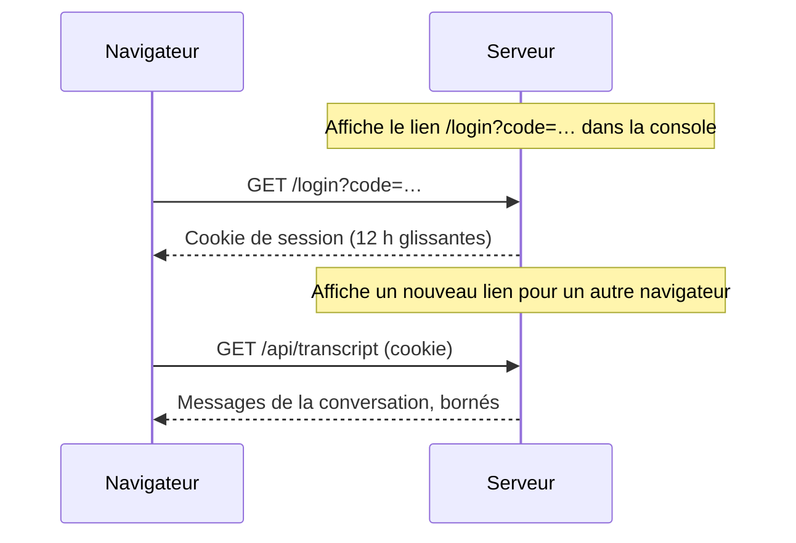

# Agent Office

Un petit bureau en 3D où chaque agent Claude Code du poste local est un personnage. On voit qui travaille, sur quoi, qui attend une réponse et qui a fini.

- **Une entreprise par environnement** de l'app desktop Claude (un nom et ses dossiers). On passe de l'une à l'autre.
- **Un donjon de 14 lieux**, reliés par des couloirs (le plan est dans [docs/lieux-et-personnages.md](docs/lieux-et-personnages.md)). Les agents passent par les portes et les couloirs, jamais à travers un mur.
  - **L'agent principal et les sous-agents génériques** (Explore, general-purpose…) vont dans la pièce de l'outil qu'ils utilisent :
    - **Bibliothèque** : lecture et recherche (`Read`, `Grep`, `Glob`) ;
    - **Observatoire** : web (`WebFetch`, `WebSearch`) ;
    - **Atelier** : écriture (`Edit`, `Write`, `NotebookEdit`) ;
    - **Salle des machines** : commandes (`Bash`, `PowerShell`) ;
    - **Salle des cartes** : planification (`EnterPlanMode`, `ExitPlanMode`, `TodoWrite`), et à chaque nouveau prompt.
  - **Les sous-agents spécialisés** restent à leur poste quel que soit l'outil : Hermione et Dexter en salle des épreuves, Oracle à l'observatoire, Turing au cabinet de l'arithméticien, Curator et Otis au Scriptorium, etc. Hancock quitte son réduit pour l'atelier quand il modifie du code.
  - **L'autel des requêtes**, au centre : tout agent qui a besoin de toi (permission, question, erreur) y fait la queue, le plus ancien en tête, à genoux. La file avance quand il repart, et contourne la nef par les couloirs si elle s'allonge. Un agent qui attend seulement ton prochain message reste à la taverne.
  - **La taverne** : au repos, elle contient un exemplaire de chaque type d'agent connu de l'environnement affiché. Un appel fait sortir celui de la taverne, qui prend la couleur de sa session et va à son poste. Les appels simultanés sortent des casiers. Un sous-agent qui a fini reprend la couleur neutre, retourne à la taverne et disparaît à son arrivée. L'agent principal y attend ton prochain message, dans la couleur de sa session.
  - Chaque pièce a ses places. Un agent garde la sienne tant qu'il reste dans la pièce ; quand elle est pleine, les suivants se tiennent le long des murs.
- **Une carte en vrais modèles 3D** : dalles de pierre, de bois ou de terre selon la pièce, murs avec fenêtres, arches, torches et bannières aux couleurs de la pièce, meubles et objets de décoration, ombres douces.
  - **Déplace la souris pour découvrir les salles.** Les murs situés devant le curseur s'enfoncent dans le sol, et il ne reste qu'un muret qui marque le contour des pièces. Ceux situés derrière restent debout.
- **Trois états.**
  - Vert : il travaille.
  - Ambre : il attend ton prochain message. Un petit losange ambre s'affiche au-dessus de son étiquette.
  - Gris : il a terminé. Il reste immobile, en pose calme.
- **La bulle de requête.** Un agent qui a besoin de toi porte au-dessus de son étiquette une bulle de BD rouge : « … » pour une permission, « ? » pour une question, « ! » pour une erreur. Il se place alors à l'autel des requêtes.
- **Les sous-agents** apparaissent comme des collègues de la même couleur que leur session. Ils surgissent du sol à leur arrivée.
- **Des personnages animés** (pack KayKit Adventurers 2.0) : un chevalier pour l'agent principal, un voyou encapuchonné pour les sous-agents.
  - Ils marchent ou courent entre les pièces, et font une animation de travail quand ils travaillent.
  - En attente, ils regardent autour d'eux, le losange ambre restant affiché. Le premier de la file s'agenouille devant l'autel.
  - Chaque personnage a un disque au sol de la couleur de sa session, et le bord de son étiquette porte cette même couleur. L'étiquette du personnage sélectionné a un contour bleu et du texte en gras.
  - Si la réduction des animations est activée dans le système, les personnages gardent une pose fixe et n'effectuent pas de surgissement, mais ils se déplacent toujours d'une pièce à l'autre.
- **Un clic sur un personnage**, ou sur sa ligne dans la liste, affiche sa tâche, son outil, le temps écoulé et son dernier message, et ouvre sa [boîte de dialogue](#dialogue-avec-un-agent) en bas de la scène. La liste latérale est l'équivalent complet de la vue 3D au clavier et au lecteur d'écran.
- **L'historique** liste les sessions terminées.
- **`/debug`** montre le flux brut des événements reçus.

## Prérequis

- Windows, avec Node.js 22 ou plus récent (testé avec Node 26).
- L'app desktop Claude et/ou Claude Code en ligne de commande.

## Installation

```bash
npm install
```

```bash
npm run build
```

```bash
npm run hooks:install
```

```bash
npm start
```

Ouvre ensuite http://127.0.0.1:4777.

Si le port 4777 est déjà pris (par exemple par une autre session), la configuration `agent-office-test` de `.claude/launch.json` lance un second serveur sur le port 4778. Elle ne contient pas de jeton : sans `AGENT_OFFICE_TOKEN` dans l'environnement, elle affiche l'inventaire mais refuse les hooks.

Pour le développement, `npm run dev` lance le serveur et Vite (http://127.0.0.1:5173, qui relaie `/api` et `/ws` vers le port 4777). La configuration `agent-office-web` de `.claude/launch.json` lance Vite seul, relayé vers le serveur de test du port 4778.

### Modèles 3D

La carte utilise les packs gratuits KayKit de Kay Lousberg (www.kaylousberg.com) : Dungeon Pack 1.1, RPG Tools Bits 1.0 et Fantasy Weapons Bits 1.0. Les personnages utilisent KayKit Adventurers 2.0. Ils sont sous licence CC0 : le crédit n'est pas obligatoire, on le donne quand même (voir `packages/web/public/kaykit/LICENSE.txt`). Les modèles utilisés sont déjà dans le dépôt.

Pour en ajouter un :

1. Télécharge le pack sur https://kaylousberg.itch.io/ (prix libre, 0 € convient).
2. Décompresse-le dans son propre dossier sous `assets-src/` (`dungeon/`, `rpg-tools/`, `weapons/` ou `adventurers/`). Ce dossier n'est pas versionné. Par exemple, `KayKit_Adventurers_2.0_FREE.zip` se décompresse dans `assets-src/adventurers/`.
3. Ajoute le nom du modèle dans `packages/web/src/scene/kit-manifest.json`.
4. Lance la copie vers `packages/web/public/kaykit/` :

```bash
npm run kaykit:import
```

Un pack peut être en `"format": "glb"` : ses modèles sont alors des fichiers `.glb` autonomes, sans texture séparée (`"textures": []`). L'import refuse un `.glb` qui pointe vers des fichiers externes, qui utilise une extension (comme Draco) ou dont les blocs internes (chunks) sont inattendus.

Sous Windows, l'import peut faire apparaître des `.gltf` comme modifiés, à cause des fins de ligne seulement. Pour les restaurer :

```bash
git checkout -- packages/web/public/kaykit/dungeon packages/web/public/kaykit/tools packages/web/public/kaykit/weapons
```

## Comment ça marche

```
Claude Code (app desktop, CLI)
  ├─ hooks ──► ~/.claude/agent-office/hook-relay.mjs ──POST /hooks (jeton)──►┐
  └─ fichiers locaux de l'app desktop ─────────────────────────────────────►┤
                                              Serveur Node (127.0.0.1:4777)
                                              état en mémoire ──WebSocket──► page 3D
```

- **Les hooks** donnent le temps réel : prompt envoyé, outil utilisé, permission demandée, sous-agent lancé ou terminé, fin de tour, fin de session.
- **L'inventaire** relit les fichiers de l'app desktop (au fil de leurs modifications, et toutes les 10 s). Il fournit les environnements, les sessions, leur titre et leur session parente, et indique si une session tourne. Au démarrage du serveur, il reconstruit l'état même sans hooks.
- **Le navigateur** reçoit un instantané complet de l'environnement affiché, au plus toutes les 100 ms. Une reconnexion suffit donc à tout resynchroniser.

### Langues

L'interface existe en français, en allemand et en anglais. Les boutons `FR | DE | EN`, en haut à droite, changent la langue à la volée, sur toutes les pages. À la première visite, la page suit la langue du navigateur, ou le français s'il n'est réglé sur aucune des trois. Le choix est ensuite mémorisé dans le navigateur.

Les titres de sessions, noms d'environnements, tâches et messages des agents s'affichent tels qu'ils ont été écrits. Les journaux du serveur restent en français.

## Dialogue avec un agent

Clique sur un personnage dans la 3D, ou sur sa ligne dans la liste des sessions. Une boîte de dialogue s'ouvre en bas de la scène et affiche la conversation de l'agent, comme dans un jeu de rôle :

- tes messages ;
- les réponses de l'agent ;
- une ligne courte pour chaque outil appelé. Le contenu brut des résultats et la réflexion de l'agent ne s'affichent pas.

Pour un sous-agent, la boîte affiche sa propre conversation. La consigne qu'il a reçue s'affiche sous le nom « Agent principal ».

- **Historique.** Fais défiler vers le haut, ou clique sur « Charger les messages précédents ».
- **Nouveaux messages.** Ils arrivent tout seuls : le serveur relit la conversation toutes les 2 s.
- **Fermer.** Clique sur × ou appuie sur Échap. La boîte se ferme et l'agent reste sélectionné.
- **Lecture seule.** La boîte n'a pas encore de zone de saisie. Répondre à un agent depuis la 3D fera l'objet d'une phase distincte (voir [Limites et suite](#limites-et-suite)).

Le texte des conversations s'affiche comme du texte brut. Il n'est jamais interprété comme du HTML.

### Connexion

Les conversations sont protégées. La 3D et la liste des sessions restent visibles sans connexion.

1. Au démarrage, la console du serveur affiche un lien de connexion à usage unique, valable 10 minutes :

   ```
   http://127.0.0.1:<port>/login?code=…
   ```

   Le port est celui de Vite (5173) quand le client n'est pas compilé, et celui du serveur (4777 par défaut) sinon.
2. Ouvre ce lien dans ton navigateur. Il pose un cookie de session : `HttpOnly`, `SameSite=Strict`, valable 12 h. Chaque utilisation prolonge la durée de 12 h.
3. Un lien expiré renvoie vers la page de connexion avec un message. La console affiche alors un nouveau lien.
4. Après une connexion réussie, la console affiche aussi un nouveau lien. Utilise-le pour te connecter depuis un autre navigateur.
5. Un redémarrage du serveur déconnecte tous les navigateurs.

Le cookie est posé pour `127.0.0.1`, pas pour `localhost`. Utilise donc `http://127.0.0.1:<port>` partout.


*Figure: Connexion par lien à usage unique, puis lecture d'une conversation.*

## Ce que l'installation des hooks modifie

`npm run hooks:install` :

- **ajoute un hook pour 12 événements** dans le `settings.json` **global** de Claude Code (`~/.claude/settings.json`, ou `CLAUDE_CONFIG_DIR`). Tous les événements concernent donc toutes tes sessions ;
- **sauvegarde d'abord** ce fichier dans `settings.json.agent-office-<date>.bak` ;
- **copie le relais** dans `~/.claude/agent-office/hook-relay.mjs`, avec `relay.env` (jeton et port). Le relais ne s'exécute jamais depuis le dépôt ;
- **ne touche à aucun autre réglage**, ni à aucun autre hook.

Les hooks sont des commandes **asynchrones** : ils ne ralentissent jamais Claude. Le relais transmet l'événement au serveur, **ignore sa réponse**, n'affiche rien et se termine toujours sans erreur. Le serveur ne peut donc jamais influencer Claude : il observe seulement. Si le serveur est arrêté, rien ne change pour Claude.

- `npm run hooks:install -- --rotate` régénère le jeton.
- Après une modification de `scripts/hook-relay.mjs`, relance l'installation pour recopier le relais.
- Redémarre le serveur après une installation, pour qu'il prenne le jeton.
- `npm run hooks:uninstall` retire les hooks (avec une sauvegarde) et supprime `~/.claude/agent-office`.

## Données lues

Tout est lu en lecture seule. Seuls ces fichiers sont ouverts :

- `%LOCALAPPDATA%\Claude-Data\claude_*\ccd-session-presets.json` : les environnements ;
- `…\claude-code-sessions\<compte>\<org>\local_*.json` et `archived-sessions.idx` : les sessions de l'app desktop ;
- `~/.claude/sessions/<pid>.json` : les processus Claude Code en cours (occupé ou au repos) ;
- `~/.claude/projects/<dossier>/<session>.jsonl` et `…/<session>/subagents/agent-<id>.jsonl` : la conversation de l'agent ouvert dans la boîte de dialogue, en lecture bornée. Le chemin est déduit de l'état du serveur.

Le serveur n'ouvre jamais `config.json` de l'app desktop (il contient des jetons de connexion) ni les fichiers `*.key`.

Ces formats sont internes à Claude et peuvent changer d'une version à l'autre. Les lectures sont tolérantes : un champ manquant est ignoré, et un fichier en cours d'écriture ne fait pas disparaître une session.

## Sécurité

- Le serveur écoute sur `127.0.0.1` uniquement. Il refuse un en-tête `Host` ou `Origin` inconnu, ce qui protège contre le DNS rebinding et les pages web malveillantes.
- `POST /hooks` exige le jeton, vérifié avant même la lecture de la requête.
- Les pages ne peuvent pas être intégrées dans une iframe (`X-Frame-Options: DENY`, `frame-ancestors 'none'`).
- **Conversations.** `GET /login` consomme le lien à usage unique et pose le cookie de session. `POST /logout` le supprime (aucun bouton de l'interface ne l'appelle encore). `GET /api/transcript` exige ce cookie.
- **Chemin du transcript.** Il est déduit de l'état du serveur, jamais d'une valeur envoyée par le navigateur ou par un hook.
- **Lecture bornée.** Le serveur ne lit qu'une partie bornée de la conversation. Le texte est affiché comme du texte, jamais interprété en HTML.
- **Limite connue.** Les routes de l'inventaire (`/api/*`, hors `/api/transcript`) et le WebSocket ne demandent pas d'authentification. Tout programme local peut donc lire les titres, dossiers, prompts et commandes (tronqués). Une authentification par session est prévue avant toute fonction qui permettrait d'agir sur les agents.
- **Sur un poste partagé**, restreins les droits du dossier du projet. Un lecteur secondaire comme `F:\` donne souvent le contrôle total aux « Utilisateurs authentifiés ». Dans une invite de commandes administrateur :

```bash
icacls "C:\chemin\vers\agent-office" /inheritance:r /grant:r "%USERNAME%:(OI)(CI)F" "*S-1-5-18:(OI)(CI)F" "*S-1-5-32-544:(OI)(CI)F"
```

## Variables d'environnement

| Variable | Rôle | Défaut |
|---|---|---|
| `AGENT_OFFICE_PORT` | Port du serveur | `4777` (ou `relay.env`) |
| `AGENT_OFFICE_TOKEN` | Jeton des hooks (32 caractères minimum) | `relay.env` |
| `AGENT_OFFICE_DESKTOP_DATA` | Dossier `Claude-Data\claude_*` de l'app desktop | détecté |
| `AGENT_OFFICE_RELAY_DIR` | Dossier du relais et de `relay.env` | `~/.claude/agent-office` |
| `AGENT_OFFICE_SETTINGS` | Fichier `settings.json` à modifier | `~/.claude/settings.json` |
| `CLAUDE_CONFIG_DIR` | Dossier de configuration de Claude Code | `~/.claude` |

## Tests

```bash
npm test
```

```bash
npm run typecheck
```

## Limites et suite

- Tous les sous-agents portent le même modèle (Rogue_Hooded). Les silhouettes propres à chaque type d'agent (Hermione, Dexter…) restent à faire.
- La scène fait environ 700 appels de dessin par image, ombres comprises : les meubles ne sont pas encore regroupés en instances. Des assets Unreal ne seraient utilisables que si leur licence Fab autorise un usage hors Unreal Engine.
- La boîte de dialogue est en lecture seule. Répondre aux agents depuis la 3D (permission, question) fera l'objet d'une phase distincte. La connexion par lien posée ici (cookie de session) servira à cette phase. Envoyer un prompt libre à une session déjà ouverte n'a pas encore de solution officielle.
- Le plan complet se trouve dans [plans/plan-agent-office-2026-11-13.md](plans/plan-agent-office-2026-11-13.md).
