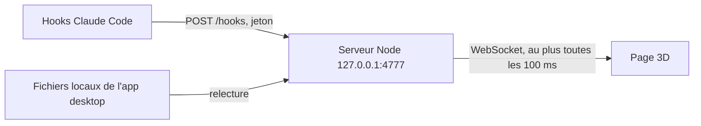
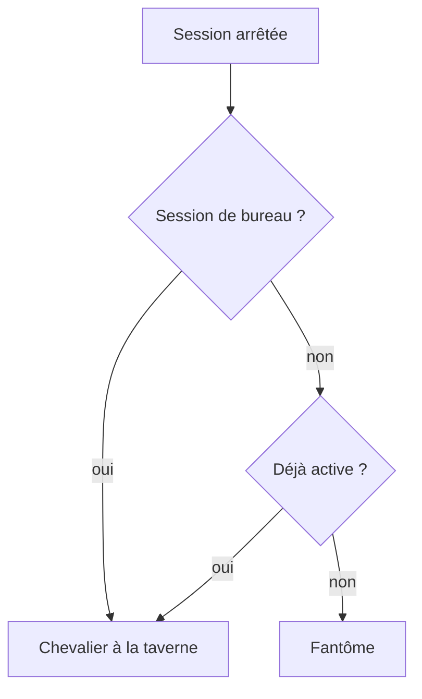

# Fonctionnement

Ce document explique comment Agents’ lAIr reçoit ses informations, ce que l'installation modifie sur ton poste, et quelles variables d'environnement il lit. Pour l'usage à l'écran, voir [utilisation.md](utilisation.md).

## Comment ça marche

```
Claude Code (app desktop, CLI)
  ├─ hooks ──► ~/.claude/agent-office/hook-relay.mjs ──POST /hooks (jeton)──►┐
  └─ fichiers locaux de l'app desktop ─────────────────────────────────────►┤
                                              Serveur Node (127.0.0.1:4777)
                                              état en mémoire ──WebSocket──► page 3D
```

Le serveur reçoit les informations par trois chemins.


*Figure : Les trois chemins de données, du relevé à la page.*

- **Les hooks** donnent le temps réel : prompt envoyé, outil utilisé, permission demandée, sous-agent lancé ou terminé, fin de tour, fin de session.
- **L'inventaire** relit les fichiers de l'app desktop (au fil de leurs modifications, et toutes les 10 s). Il fournit les donjons (un par environnement de l'app Claude), les sessions, leur titre et leur session parente, et indique si une session tourne. Au démarrage du serveur, il reconstruit l'état même sans hooks.
- **Le navigateur** reçoit un instantané complet du donjon affiché, au plus toutes les 100 ms. Une reconnexion suffit donc à tout resynchroniser.

## Ce que l'installation des hooks modifie

`npm run hooks:install` :

- **ajoute un hook pour 12 événements** dans le `settings.json` **global** de Claude Code (`~/.claude/settings.json`, ou `CLAUDE_CONFIG_DIR`). Tous les événements concernent donc toutes tes sessions ;
- **sauvegarde d'abord** ce fichier dans `settings.json.agent-office-<date>.bak` ;
- **copie le relais** dans `~/.claude/agent-office/hook-relay.mjs`, avec `relay.env` (jeton et port). Le relais ne s'exécute jamais depuis le dépôt ;
- **ne touche à aucun autre réglage**, ni à aucun autre hook.

Les hooks sont des commandes **asynchrones** : ils ne ralentissent jamais Claude. Le relais transmet l'événement au serveur, **ignore sa réponse**, n'affiche rien et se termine toujours sans erreur. Le serveur ne peut donc jamais influencer Claude : il observe seulement. Si le serveur est arrêté, rien ne change pour Claude.

- `npm run hooks:install -- --rotate` régénère le jeton.
- Après une modification de `scripts/hook-relay.mjs`, relance l'installation pour recopier le relais.
- Redémarre le serveur après une installation, pour qu'il prenne le jeton.
- `npm run hooks:uninstall` retire les hooks (avec une sauvegarde) et supprime `~/.claude/agent-office`.

## Sessions sans activité

Le serveur sait si une session a déjà travaillé. Il la considère comme **active** dès qu'il reçoit l'un de ces signaux :

- un hook de travail : `UserPromptSubmit`, `PreToolUse`, `PostToolUse`, `PostToolUseFailure`, `PermissionRequest`, `SubagentStart`, `SubagentStop`, `Stop` ou `StopFailure`. Les hooks `SessionStart`, `SessionEnd` et `Notification` ne comptent pas ;
- le processus Claude signale qu'il est occupé ;
- à la découverte du processus, un transcript `~/.claude/projects/<dossier>/<session>.jsonl` non vide existe déjà.

Une session de bureau est toujours active. Une fois active, une session le reste, même après son arrêt. Pendant que son processus tourne, une session garde son chevalier, même sans activité. Une session du terminal qui s'arrête sans avoir été active devient un fantôme (voir [personnages.md](personnages.md#le-fantôme)).


*Figure : Choix entre chevalier et fantôme pour une session arrêtée.*

## Données lues

Tout est lu en lecture seule. Seuls ces fichiers sont ouverts :

- `%LOCALAPPDATA%\Claude-Data\claude_*\ccd-session-presets.json` : les environnements ;
- `…\claude-code-sessions\<compte>\<org>\local_*.json` et `archived-sessions.idx` : les sessions de l'app desktop ;
- `~/.claude/sessions/<pid>.json` : les processus Claude Code en cours (occupé ou au repos) ;
- `~/.claude/projects/<dossier>/<session>.jsonl` et `…/<session>/subagents/agent-<id>.jsonl` : la conversation de l'agent ouvert dans la boîte de dialogue, en lecture bornée. Le chemin est déduit de l'état du serveur ;
- `~/.claude/agents/*.md` et `<dossier>/.claude/agents/*.md`, pour chaque dossier du donjon affiché : les définitions d'agents, qui forment la liste de la taverne. Seuls les fichiers dont l'en-tête contient un champ `name:` comptent. Ces dossiers sont relus au plus une fois par minute ;
- `<dossier de session>/.claude/launch.json` : les ports seulement, dans la limite de 64 KiB. Il sert à détecter les serveurs web d'une session ;
- pour les sessions du terminal, le serveur vérifie si `<cwd>/.git` est un fichier. C'est le signe d'un worktree ;
- toutes les 10 s, tant qu'une session est en cours : la liste des ports en écoute et des processus qui les ouvrent. Sous Windows, cela passe par `netstat -ano` et une requête PowerShell sur `Win32_Process`. Ailleurs, par `lsof` et `ps`.

Pour chaque processus Claude en cours, le serveur vérifie aussi si son transcript `~/.claude/projects/<dossier>/<session>.jsonl` existe et n'est pas vide. Il ne fait qu'un `lstat` : le fichier n'est ni ouvert ni lu, et un lien symbolique n'est jamais suivi. Cette vérification a lieu à chaque relecture de l'inventaire.

Les lignes de commande des processus ne quittent jamais le serveur. Seuls le port et le nom du processus sont envoyés à la page.

Le serveur n'ouvre jamais `config.json` de l'app desktop (il contient des jetons de connexion) ni les fichiers `*.key`.

Ces formats sont internes à Claude et peuvent changer d'une version à l'autre. Les lectures sont tolérantes : un champ manquant est ignoré, et un fichier en cours d'écriture ne fait pas disparaître une session.

## Variables d'environnement

| Variable | Rôle | Défaut |
|---|---|---|
| `AGENT_OFFICE_PORT` | Port du serveur | `4777` (ou `relay.env`) |
| `AGENT_OFFICE_TOKEN` | Jeton des hooks (32 caractères minimum) | `relay.env` |
| `AGENT_OFFICE_DESKTOP_DATA` | Dossier `Claude-Data\claude_*` de l'app desktop | détecté |
| `AGENT_OFFICE_RELAY_DIR` | Dossier du relais et de `relay.env` | `~/.claude/agent-office` |
| `AGENT_OFFICE_SETTINGS` | Fichier `settings.json` à modifier | `~/.claude/settings.json` |
| `CLAUDE_CONFIG_DIR` | Dossier de configuration de Claude Code | `~/.claude` |
| `CLAUDE_HOME` | Dossier de configuration de Claude Code, lu si `CLAUDE_CONFIG_DIR` n'est pas défini | `~/.claude` |
