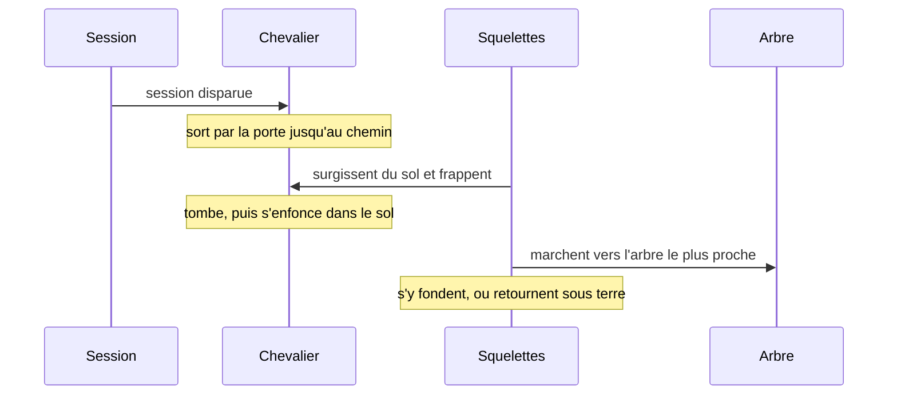
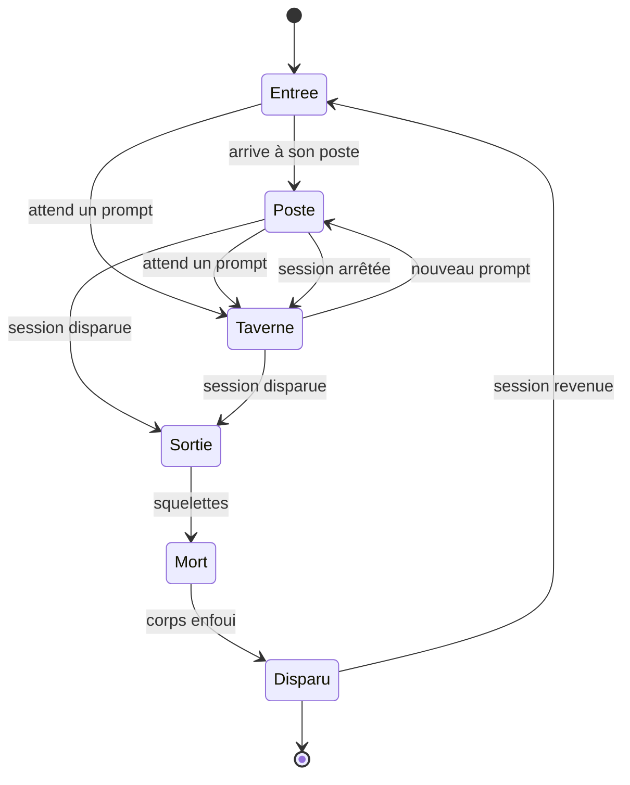

# Personnages

Ce document décrit comment chaque agent est représenté : sa silhouette, sa couleur, son poste. Pour les pièces, voir [lieux.md](lieux.md). Pour l'usage à l'écran, voir [utilisation.md](utilisation.md).

## Principes de représentation

- **La silhouette dit qui c'est.** Chaque type d'agent est une *classe* de personnage reconnaissable à sa tenue et à son accessoire. Deux Hermione ont toujours la même silhouette.
- **La couleur dit pour qui il travaille.** Tous les agents d'une même session portent la couleur de cette session, sur le disque au sol et le bord de l'étiquette. Deux Hermione de deux sessions différentes se distinguent donc par leur couleur.
- **Un même personnage peut apparaître plusieurs fois, y compris dans une seule session.** La session principale peut lancer plusieurs sous-agents du même type en parallèle, par exemple trois Explore ou deux Oracle sur des sujets différents. Ils ont alors la même couleur et la même silhouette. Aujourd'hui, les figures sont identiques. Un badge numéroté (1, 2, 3) ou une légère variation de teinte est prévu pour les distinguer : voir [conception.md](conception.md).
- **Le poste suit le rôle, pas l'outil, pour les agents spécialisés.** Un agent spécialisé reste à son poste attitré ; l'outil en cours ne change que son animation (il feuillette, il écrit, il calcule). L'agent principal et les agents génériques (Explore, general-purpose…) se déplacent selon l'outil. Voir le tableau outil → pièce dans [utilisation.md](utilisation.md).
- **Clichés, pas copies.** Plusieurs noms viennent d'œuvres protégées (Barbapapa, Hermione, Neo, Dexter, Gatsby, Dora, Bob le bricoleur…), et le style s'inspire du genre « Warcraft » sans en reprendre les modèles. On s'inspire du *métier* que le nom évoque, jamais du look du personnage d'origine : pas de blob rose pour Barbapapa, pas de baguette ni de robe de sorcier pour Hermione. C'est aussi ce qui permet d'utiliser des modèles CC0. Exception acceptée pour l'instant : Hermione porte le corps Mage du pack KayKit (chapeau et robe), faute d'un modèle d'érudite.

## L'agent principal

C'est le personnage central de chaque session, celui qui dialogue avec l'humain et coordonne les autres. Il est représenté par un **chevalier** du pack KayKit Adventurers 2.0, de la couleur de sa session.

Quand il attend ton prochain prompt, il se repose à la taverne (voir [lieux.md](lieux.md#la-taverne-et-le-cycle-de-vie-dun-agent)).

Les tenues prévues selon le mode de travail ne sont pas encore en place. Elles sont décrites dans [conception.md](conception.md).

### Entrée et sortie du chevalier

Seul l'agent principal de chaque session entre et sort du château, sous la forme d'un chevalier. Les sous-agents suivent toujours le cycle de la taverne, décrit dans [lieux.md](lieux.md#la-taverne-et-le-cycle-de-vie-dun-agent).

- **Arrivée.** Quand une nouvelle session apparaît, son chevalier arrive à pied par le chemin de la forêt, juste au-delà de la zone visible. Il traverse le pont-levis, passe la porte du château, puis marche jusqu'à son poste. Au chargement de la page, ou quand on change d'environnement, les agents déjà présents restent à leur place.
- **Session arrêtée.** Une session dont le processus Claude est fermé, mais qui peut encore être reprise, garde son chevalier endormi à la taverne, dans la couleur de la session. Ce chevalier ne se sélectionne pas en 3D : la liste latérale ne montre que les sessions actives.
- **Départ.** Quand une session disparaît (supprimée, archivée, purgée au bout de 60 minutes une fois terminée, ou repoussée hors de l'historique des 30 dernières sessions), son chevalier quitte le château par la porte et marche jusqu'à un point du chemin, en dehors du donjon.
- **Embuscade.** Trois squelettes au plus sortent du sol autour du chevalier et le frappent. Ce sont des `Skeleton_Minion` nus, armés d'une épée, d'une hache et d'une épée (pack KayKit Skeletons 1.1, voir [modeles-3d.md](modeles-3d.md)). Le chevalier tombe, puis son corps s'enfonce dans le sol. Chaque squelette marche ensuite vers l'arbre le plus proche, s'il est assez près, et s'y fond. Sinon, il retourne sous terre.
- **Plusieurs départs à la fois.** Les squelettes sont partagés : chaque chevalier en a au moins un. Les autres victimes attendent debout sur le chemin.
- **Retour pendant une mort.** Si la session revient pendant que son chevalier meurt, la mort se termine d'abord. Un nouveau chevalier arrive ensuite par le chemin.

Le schéma suivant montre le départ d'un chevalier, de la suppression de la session à la disparition des squelettes.

*Figure : Départ d'un chevalier après la suppression de sa session.*

Le schéma suivant résume les états du chevalier de l'agent principal.

*Figure : États du chevalier de l'agent principal, de l'entrée à la disparition.*

## Les sous-agents spécialisés

Ce sont les agents définis dans `~/.claude/agents/`, ou dans le `.claude/agents/` d'un dossier de l'environnement. Le hook `SubagentStart` donne leur type dans `agent_type`, ce qui permet de choisir la silhouette.

| Agent | Rôle | Cliché visuel | Accessoire | Poste | Aujourd'hui (KayKit) |
|---|---|---|---|---|---|
| **barbapapa** | Découpe des maquettes en templates HTML/CSS | Enlumineur : béret, blouse tachée de couleurs | Palette et pinceau | Atelier, coin de l'enlumineur | Voleur, marteau |
| **butt-stallion** | Idées loufoques, brainstorming | Bouffon : chapeau à grelots, habit bariolé | Marotte, ampoule magique qui s'allume au-dessus de la tête | Coin détente | Barbare, chope pleine |
| **samuel-morse** | Teste les API externes | Colombophile messager : sacoche, gants de cuir | Pigeon sur l'épaule, rouleaux de messages | Pigeonnier | Rôdeur, carte roulée (message) |
| **neo** | Audit sécurité | Garde de la herse : armure légère, capuche | Lanterne, trousseau de clés | Poste de garde | Barbare, lanterne et bouclier à pointes |
| **oracle** | Recherche sur Internet | Astrologue voyante : robe étoilée, châle | Boule de cristal qui affiche des pages, lunette | Observatoire | Mage, bâton |
| **dexter** | Écrit les tests | Alchimiste : tablier brûlé, lunettes de protection | Fioles qui fument en vert (réussi) ou en rouge (échec) | Salle des épreuves, laboratoire | Voleur, bombe fumigène |
| **hermione** | Revue de code | Érudite relectrice : lunettes, pile de grimoires | Plume rouge | Salle des épreuves, table de relecture | Mage, grimoire ouvert |
| **gatsby** | Audit SEO (référencement) | Héraut : tabard, chapeau à plume | Trompette et bannière (« faire connaître ») | Salle Accessibilité / SEO, estrade | Voleur, bouclier à blason |
| **timmy** | Audit accessibilité | Inspecteur : manteau, besace | Loupe, cornet acoustique (lecteur d'écran) | Salle Accessibilité / SEO | Rôdeur, loupe |
| **hancock** | Nettoyage du code mort | Concierge : tablier, foulard | Balai et seau | Réduit du concierge, tournées dans l'Atelier | Barbare, seau |
| **curator** | Documentation pour les IA | Archiviste : robe de moine, gants | Registres et trousseau de clés des archives | Scriptorium | Mage, grimoire fermé |
| **otis** | Documentation pour les humains | Scribe copiste : bonnet, manches retroussées | Plume d'oie et parchemin | Scriptorium | Voleur encapuchonné, journal ouvert |
| **turing** | Calculs (exécute du Python) | Arithméticien : toque, craie à la main | Boulier géant, ardoise couverte de chiffres | Cabinet de l'arithméticien | Mage, compas |

La colonne « Aujourd'hui (KayKit) » donne le corps et l'objet réellement utilisés. Le cliché visuel est la cible.

## Les agents intégrés à Claude Code

Ils n'ont pas de fichier dans `~/.claude/agents/` mais apparaissent souvent, Explore en particulier.

| Agent | Rôle | Cliché visuel | Comportement | Aujourd'hui (KayKit) |
|---|---|---|---|---|
| **Explore** | Fouille le code local | Éclaireur : lanterne, carnet de notes | Se déplace selon l'outil, surtout Bibliothèque | Rôdeur, lanterne |
| **Plan** | Conçoit un plan d'implémentation | Cartographe : compas, cartes roulées | Salle des cartes | Voleur encapuchonné, carte |
| **general-purpose** | Tâches variées | Apprenti compagnon : besace d'outils | Se déplace selon l'outil | Voleur encapuchonné, dague |
| **fork** | Copie de l'agent principal | Même tenue que l'agent principal, un peu fantomatique | Se déplace selon l'outil | Corps tiré du nom du type, mains vides |
| **claude-code-guide** | Répond aux questions sur Claude Code | Sacristain : lanterne, livre de règles | À côté de l'autel | Voleur encapuchonné, lanterne |
| **statusline-setup** | — | — | — | Voleur, clé |
| **Type inconnu** | Agent d'un autre projet, d'un plugin, ou ajouté plus tard | Villageois neutre avec une étiquette au nom du type | Se déplace selon l'outil | Corps tiré du nom du type, mains vides |

Les packs KayKit ne donnent que 5 corps aux sous-agents : le rôle se lit donc dans le corps et l'objet en main.

Le type inconnu est indispensable : chaque environnement peut avoir ses propres agents dans son `.claude/agents/`, et les plugins en ajoutent.

## Changer une tenue

Une tenue se règle dans le code, à partir de la table `LOOKS` :

1. Ouvre `packages/web/src/scene/characters.ts` et modifie l'entrée `LOOKS` du type d'agent.
2. Si la tenue reçoit un outil de RPG Tools, règle aussi sa prise dans `PROP_GRIP`, à l'œil.
3. Lance `npm run dev` et vérifie le personnage dans la scène.

Les modèles disponibles et leur import sont décrits dans [modeles-3d.md](modeles-3d.md).
